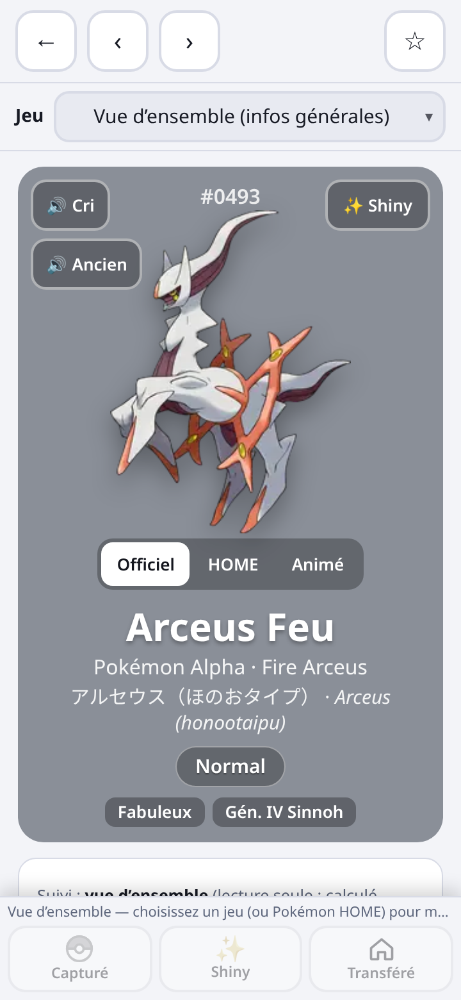
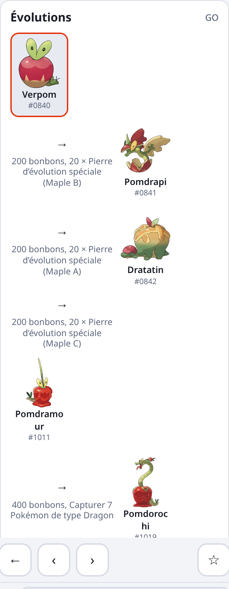
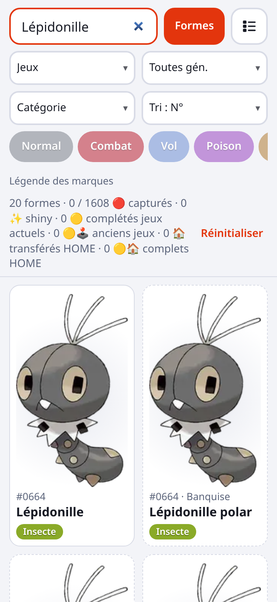
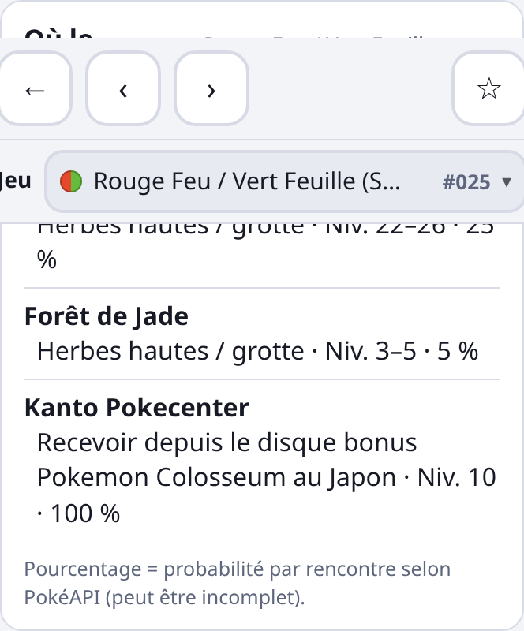

# Audit du Pokédex en ligne v33 / d13 (12/10/2026)
Audit seul, rien n'a été modifié. Version en ligne vérifiée : sw.js v33, DATA_VERSION d13 (commit 1966e4a, identique au serveur local audité).

**Méthode :**
- **Données :** scripts sur docs/data, comparés à Poképédia (noms), Serebii / Bulbapedia (Pokédex, chromatiques bloqués, Barons) et pokemondb.net/go + pokemoncenter.ai/unreleased (GO, consultés le 12/10).
- **Interface :** parcours automatique sous Chrome à 360 et 1280 px. 30 listes de jeux, et 40 fiches (formes, Méga, Gigamax) vues chacune en vue d'ensemble, HOME, GO et 3 jeux : 0 erreur console, 0 requête en échec, 0 débordement horizontal, 0 image cassée, 0 section vide, 7 liens externes tous en 200.

**Totaux :** 23 Erreurs · 15 À vérifier · 14 Améliorations. Captures dans screenshots/audit-v33/ (non suivi par git).

## Top 10 des erreurs
- 1. **Arceus et Silvallié** : les 34 formes de type sont toutes « Normal » (type, filtres, faiblesses).
- 2. **GO, 13 espèces sorties marquées indisponibles :** Mimiqui, Zeraora, Coléodôme, Astronelle, Dunaja, Dunaconda, Hastacuda, Salarsen, Tapatoès, Cléopsytra, Ferdeter, Flamenroule, Dudunsparce Triple.
- 3. **GO, 20 formes sorties marquées indisponibles :** formes de Galar (Ponyta, Galopa, Flagadoss, Roigada, M. Mime, Corayon, Tutafeh, Darumacho, oiseaux), Sancoki et Tritosor Orient, Ceriflor Ensoleillé, Zygarde 10 %, Plumeline Pom-Pom, Necrozma Crinière / Ailes, Zacian / Zamazenta Suprême.
- 4. **Mordudor (GO) :** la forme Coffre est marquée disponible et la forme Marche indisponible, alors que GO n'a que la forme Marche.
- 5. **Barons Z-A :** proposés pour 462 entrées (starters, cadeaux, fossiles…), alors que seules ~147 rencontres Baron existent.
- 6. **Let's Go :** 33 Méga d'espèces hors Kanto comptées dans le jeu (186 au lieu de 153 ; filtre Méga 48 au lieu de 19).
- 7. **Lieux de capture absents** pour DÉ/PS, Légendes Arceus, ÉV (+2 DLC), Z-A (+DLC).
- 8. **Noms de formes en anglais :** « Lépidonille polar », « Pérégrain meadow »… (40 entrées) et « Papilord sandy / trash ».
- 9. **Hors-ligne :** l'indicateur « ✓ … disponibles hors-ligne » reste affiché après un changement de DATA_VERSION, alors que le cache des données a été vidé.
- 10. **Évolutions GO :** « Pierre d'évolution spéciale (Maple A/B/C) » pour Verpom, et « ? + 999 × Pierre d'évolution spéciale » pour Mordudor.

## Erreur
| Quoi | Où | Correction proposée |
|---|---|---|
| Types des formes = Normal (17 Arceus + 17 Silvallié) ; faiblesses Combat sur Arceus Feu | core.json / sp 493, 773 ; fiche Arceus Feu (capture arceus-feu-type-normal.png) | Reprendre les types de chaque forme (PokéAPI pokemon/arceus-fire…) ; ajouter un test sur le type des formes |
| GO : 13 espèces disponibles marquées « indisponibles » (liste au top 10) | GO, HOME (marque GO absente → dorure HOME et « jeux actuels » faussées) | Ne plus utiliser la liste pogoapi released_pokemon, qui n'est plus mise à jour ; dériver la sortie depuis pokemondb ou une liste manuelle dans go-overrides.json |
| GO : formes de Galar sorties marquées indisponibles (Ponyta, Galopa, Flagadoss, Roigada, M. Mime, Corayon, Tutafeh, Artikodin, Électhor, Sulfura) | Onglet GO absent (ex. M. Mime de Galar) | Liste pogoapi galarian_pokemon incomplète : la compléter dans go-overrides.json |
| GO : Darumacho de Galar Normal sans données GO | 555-galar-standard | La clé « galar-standard » ne correspond pas au suffixe « galar » : ajouter la correspondance |
| GO : Zygarde 10 %, Plumeline Pom-Pom, Necrozma Crinière / Ailes, Zacian / Zamazenta Suprême indisponibles | Onglet GO absent | Les marquer sorties (déjà repéré dans REVUE-FORMES-2) |
| GO : Sancoki / Tritosor Orient et Ceriflor Ensoleillé indisponibles | 422-east, 423-east, 421-sunshine | Les marquer sortis |
| GO : Dudunsparce Forme Triple indisponible | 982-three-segment | La marquer sortie |
| GO : Mordudor Coffre marqué disponible, Forme Marche indisponible | 999 / 999-roaming | Inverser : seule la Forme Marche existe dans GO |
| GO : évolution de Mordudor affichée « ? + 999 × Pierre d'évolution spéciale » | Fiche 999, onglet GO (go-evo-mordudor-999.png) | Afficher « 999 Pièces de Mordudor », sans bonbons |
| GO : « Pierre d'évolution spéciale (Maple A/B/C) » (code interne) | Verpom → Pomdrapi / Dratatin / Pomdramour (go-evo-maple-840.png) | Afficher Pomme Acidulée / Pomme Sucrée / Pomme Nectar |
| Barons Z-A ouverts à toute espèce non légendaire du jeu (462 entrées, dont starters, Kanto en cadeau, Ptéra…) | Catégories Barons et boutons Baron, Z-A | Liste explicite des Barons Z-A (Serebii « Alpha Pokémon », ~147) |
| Let's Go : 33 Méga hors Kanto (Méga-Pharamp → Méga-Diancie) dans le jeu | Liste Let's Go 186 au lieu de 153 ; Méga 48 au lieu de 19 | Vider dex/lgpe.json « x » ; ne garder que les 19 Méga de Kanto |
| Aucun lieu de capture pour 8 jeux récents (DÉ/PS, LA, ÉV + 2 DLC, Z-A + DLC) | Fiches, section capture (sv-sans-lieux-6.png) | Importer depuis Serebii / Poképédia, ou afficher « lieux non renseignés pour ce jeu » |
| Lieu de RF/VF Switch recopié de la GBA, en anglais : « Kanto Pokecenter · Recevoir depuis le disque bonus Pokemon Colosseum au Japon » | Pikachu, RF/VF Switch (frlgsw-pokecenter-25.png) | Retirer de frlgsw ; traduire « Pokecenter » partout (Hoenn / Kanto Pokecenter) |
| Noms de formes en anglais : Lépidonille / Pérégrain × 20 motifs (polar, tundra, meadow, poke-ball…) | Liste avec « Formes » (liste-lepidonille-formes.png) | Utiliser les motifs FR (Banquise, Toundra, Floraison…) ; ou fusionner en une forme, comme Yann l'a décidé |
| « Papilord sandy / trash » : fausses formes (Papilord n'a pas de cape) | 414-sandy, 414-trash | Supprimer les entrées (fusion décidée par Yann) |
| Faute : « Météno Noyeau … » (7 formes) | 774-red… | « Noyau » (Poképédia) |
| Nom doublé : « Zygarde Forme 10 % (10 %) » | Fiche, chromatique Z-A (zygarde-10-nom.png) | « Zygarde Forme 10 % » |
| Zygarde 10 % absent de Z-A et ÉB, alors que la fiche Shiny Z-A le cite | Sélecteur de jeux de 718-10 : USUL / SL seulement | Ajouter la disponibilité Z-A (Cube Zygarde) ; ÉB à vérifier |
| « Floette Éternel » | 670-eternal | « Floette Fleur Éternelle » (Poképédia) |
| Hors-ligne : packDone2 / imgsDone jamais remis à zéro quand DATA_VERSION change (d12 → d13 a vidé le cache des données) | Écran hors-ligne : « ✓ Formes, fiches… disponibles » est faux | Enregistrer la DATA_VERSION avec le drapeau ; proposer de retélécharger si elle diffère |
| Traductions automatiques : restes d'anglais et unités impériales (« TRAINERS », « BERRIES », « RATTATA », « DIG », « pieds », « miles ») ; 313 textes avec un mot anglais en capitales | Descriptions (src 'tr'), ex. Roucarnage, Taupiqueur, Dracaufeu | Remplacer par les textes officiels FR (Poképédia), qui existent pour tous ces jeux |
| Traductions automatiques fautives (« Si Dracaufeu vient furieuse », « On dit que le feu de Dracaufeu s'il a connu… ») | Dracaufeu, et 4 632 textes « traduction automatique » | Idem : textes officiels Poképédia (Gén. I–V, LA, ÉV) |

## À vérifier
| Quoi | Où | Correction proposée |
|---|---|---|
| GO : Larvadar, Embrochet, Toxizap, Théffroi, Flotillon (pokemondb : sortis ; pokemoncenter : non) | Disponibilité GO | Trancher avec Bulbapedia, puis go-overrides |
| GO : Grondogue / Dogrino (pokemoncenter : sortis ; pokemondb : non) | Disponibilité GO | Idem |
| GO : Motisma Hélice, Meloetta Danse, Prismillon Fantaisie, Ultra-Necrozma, Darumacho Transe marqués sortis ; pokemondb les liste indisponibles | GO / dorure HOME | Vérifier puis corriger go-overrides |
| GO : Pikachu à casquette (8) indisponibles | 25-*-cap | Vérifier les événements GO |
| Barons Légendes Arceus : Zarbi, Spiritomb, starters (Brindibou, Héricendre, Moustillon) et bébés proposés comme Barons | Catégories / boutons Baron, LA (319 entrées) | Comparer à la liste Serebii des Barons LA ; exclure si confirmé |
| RF/VF Switch : 0 Pokémon hors dex (la GBA en avait 235 avec le Pokédex National et les Îles Sevii) | frlgsw count 151 + 0 | Vérifier le contenu du portage Switch |
| Isolarmure : 211 comptés, mais le jeu demande 210 (Zarude non requis) | Compteur ÉB Isolarmure | Signaler « Zarude non requis » ou compter 210 |
| 52 Méga sans méga-gemme propre (icône / nom génériques « Méga-Gemme ») : Raichu X/Y, Mélodelfe… Méga-Dimension | mega-stones.json | Ajouter les noms FR officiels des gemmes Z-A |
| Primo-Kyogre / Groudon sans Orbe Bleu / Rouge | mega-stones.json | Vérifier l'affichage ; ajouter les orbes |
| « Cave Connecterre », « Lavandia Sea (Intérieur) » | loc.json (lieux) | Vérifier le nom officiel FR (Poképédia) |
| Lieux : Minidraco RB « Casino de Céladopole [Cadeau] » est un échange de jetons, pas un cadeau | loc.json, méthode | Méthode « Échange de jetons » |
| Z-A Chromatique : Raichu d'Alola, Ramoloss / Limonde de Galar notés « ne peut pas être chromatique » | shiny.json za | Vérifier sur Serebii Z-A |
| Shiny Rouge Feu / Vert Feuille Switch : seul Celebi noté bloqué | shiny.json frlgsw | Vérifier Mew / Deoxys / Jirachi (événements) sur Switch |
| GO → HOME : les Fabuleux n'ont pas de marque GO ; Meltan / Melmetal à confirmer | homeAvail | Vérifier la règle de transfert de Meltan |
| Sancoki / Tritosor « Orient », Xerneas « Paisible », Darumacho « Transe » ; Poképédia dit « Mer Orient », « Mode Paisible », « Mode Transe » | Noms de formes | Harmoniser, si Yann préfère la forme officielle |

## Amélioration
| Quoi | Où | Correction proposée |
|---|---|---|
| Catégorie Ultra-Chimères visible dans des jeux qui n'en ont pas (Rouge/Bleu, ÉV, X/Y…) | Sélecteur Catégorie | La masquer comme Méga / Gigamax / Barons |
| « Méga-Mistigrix (Méga ♂) » : « Méga » en double | 678-*-mega | « Méga-Mistigrix ♂ / ♀ » |
| Tri : pas d'Att. Spé / Déf. Spé | Sélecteur Tri | Ajouter les 2 tris |
| Cache images « cache-first » sans version : une image remplacée reste ancienne chez l'utilisateur | sw.js, pokedex-img | Versionner le cache images ou ajouter ?v= |
| Données en « stale-while-revalidate » : après la routine GO hebdo, la 1ʳᵉ ouverture montre l'ancienne donnée | sw.js, /data/ | Bump d'une version de contenu, ou réseau d'abord pour core / go |
| data/core.json pré-caché dans le shell, mais servi par le cache des données (copie inutile) | sw.js SHELL_FILES | Le retirer de SHELL_FILES, ou le pré-cacher dans DATA |
| Le bouton images ne télécharge que les formes de base (!p.c) | cacheImages | Inclure les formes, ou le préciser dans le libellé |
| Manifest : « Pokédex en français, hors-ligne, pour Pokémon GO » (description dépassée) | manifest.webmanifest | « … pour tous les jeux et Pokémon GO » |
| Source GO figée : pogoapi.net (released, galarian, mega, shiny) n'est plus maintenu | build/go.mjs | Passer au game master PokeMiners + liste de sortie maintenue |
| Traductions automatiques : la mention existe, mais les textes officiels sont disponibles | Descriptions | Priorité : Poképédia → PokéAPI → traduction auto |
| Lieux : 4 jeux GBA/DS sans lieux pour une partie des espèces | loc / en | Compléter avec Poképédia |
| Prismillon / Lépidonille / Pérégrain : 20 motifs × 3 espèces = beaucoup d'entrées | Liste « Formes » | Appliquer la fusion décidée par Yann |
| Étymologies : « Anglais : Unown… » correct, mais certains textes mélangent japonais et anglais | Section origine du nom | Rien d'urgent |
| Vérification automatique : pas de test sur les types des formes, la disponibilité GO face à une source tierce, ni le compteur Let's Go | build/test.mjs, audit.mjs | Ajouter ces 3 contrôles |

## Captures (screenshots/audit-v33/)

## Ce qui est correct (échantillon vérifié)
- Effectifs des 28 Pokédex régionaux = totaux officiels (Kanto 151 … Paldea 400, Isolarmure 211, Couronneige 210, Septentria 200, Myrtille 243, Hisui 242, Illumis 232, Méga-Dimension 132), numéros continus, sans doublon ; premier et dernier numéros contrôlés.
- 1 025 noms d'espèces = titres Poképédia. 71 Légendaires, 23 Fabuleux, 11 Ultra-Chimères. Types des autres formes testées : corrects (≈ 70 cas).
- Chromatiques bloqués : DÉ/PS (seuls Mew / Jirachi cadeaux), oiseaux de Galar dans Couronneige, Koraidon / Miraidon : conformes à Serebii.
- Méga par jeu : X/Y 30, ROSA 50 (avec Primo). Filtres Méga / Gigamax / Barons masqués là où ils n'existent pas. Bannière de mise à jour : suite test.mjs passée le 11/10 (v33).
